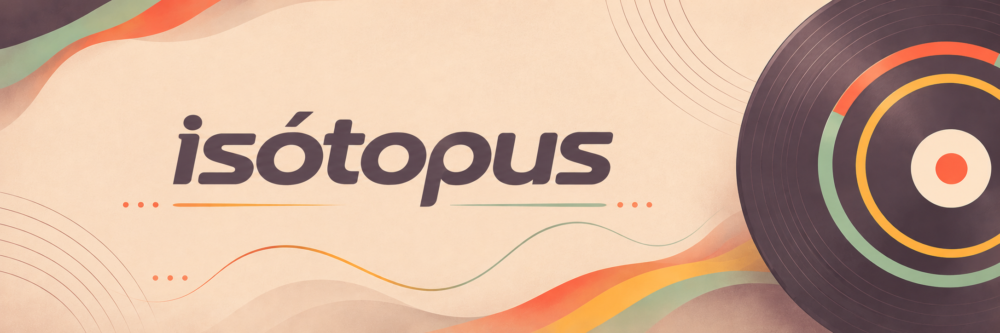

Player de música local para Linux e Windows, feito para organizar e ouvir uma coleção pessoal. A partir da versão 0.2.2, inclui uma ferramenta opcional para baixar áudio compatível para pastas locais monitoradas. A biblioteca fica no computador; o app oferece playlists, busca, favoritos, letras sincronizadas, equalizador e controles de mídia do sistema.

## Recursos

- Reprodução local de FLAC, WAV, AIFF, M4A/ALAC, MP3, AAC, Ogg e Opus, conforme o suporte do Electron e do sistema.
- Biblioteca monitorada, playlists que podem ser renomeadas, reordenadas e excluídas, busca, favoritos e fila de reprodução; ações rápidas por faixa para playlist, favorito, próxima música e exclusão confirmada do arquivo.
- Letras LRC e sincronização manual por faixa.
- Busca automática de letras no LRCLIB e sincronização estimada de letras sem tempos com o áudio local.
- Indicador da origem das letras; seletor local de modelo Whisper (Tiny/Base/Small), consulta e remoção do cache e cancelamento de análises.
- Mini player flutuante que controla a mesma reprodução da janela principal, com capa, transporte, volume e progresso.
- Fila reordenável e gerenciável; álbuns e playlists podem ser adicionados sem interromper a música atual.
- Estatísticas locais de reprodução, recomendações baseadas na biblioteca e pastas inteligentes por metadados ou reproduções.
- Visualizador de áudio com cinco modos alimentados pelos dados do áudio real; o processamento visual para quando a janela fecha ou a música pausa.
- Página Sobre e opções de aparência Padrão, Mica e Glass. As cores extraídas da capa são opcionais e complementares.
- Temas claro, escuro e automático com fundos consistentes na tela, lateral, topo e miniplayer; escala de 100% a 175%.
- Marcador do player animado durante a reprodução, com suporte à preferência por movimento reduzido.
- Abertura corrigida para carregar pastas monitoradas e ativar todos os controles; cache de capas recupera imagens ausentes.
- Letras em foco recebem transição suave, e o brilho tem margem para não ser cortado nas laterais.
- Downloads opcionais via yt-dlp oficial: faixas ou playlists com progresso individual no gerenciador de downloads, retentativas e pausas entre itens, metadados e capa no MP3; exige consentimento e FFmpeg. Playlists processam até 100 itens, e Spotify não fornece áudio para este fluxo.
- Aviso de novas versões com link para o instalador apropriado de Ubuntu/Debian, Arch ou Windows.
- Pacotes de distribuição para Debian/Ubuntu, Arch e Windows.

O editor de metadados diretamente nos arquivos ainda não está incluído: o projeto ainda não tem uma solução segura de escrita multiplataforma para todos os formatos que lê.

O app identifica o codec armazenado, mas não consegue verificar se um arquivo lossless veio de uma fonte sem perdas. A saída de áudio também pode ser mixada ou reamostrada pelo sistema operacional.

## Requisitos

- Node.js e npm para executar ou compilar a partir do código.
- Linux com bibliotecas do Electron para executar as versões Linux; Windows para executar o instalador Windows.

## Executar a partir do código

```bash
npm ci
npm start
```

Para rodar a suíte automatizada:

```bash
npm test
```

## Compilar instaladores

```bash
npm run build:debian
npm run build:arch
npm run build:windows
```

Os arquivos gerados ficam em `dist/`. O código do app fica em `src/`, organizado em `main/controllers`, `main/services`, `main/workers`, `renderer/controllers`, `renderer/styles` e `shared`. Recursos de marca e ícones ficam em `assets/`; scripts de build em `scripts/`; testes automatizados em `test/`.

## Builds publicadas

Os instaladores históricos e atuais estão organizados em `release-assets/`, por versão (`v0.1.0` a `v0.2.6`). Eles são mantidos fora dos commits e enviados como anexos de Releases do GitHub, inclusive porque alguns arquivos ultrapassam o limite de tamanho de arquivos comuns do Git.


## Instalar uma build

Baixe o instalador da versão desejada na página **Releases** do repositório e escolha o arquivo correspondente ao seu sistema:

- **Windows:** baixe `Isotopus-<versão>-setup-x64.exe`, abra o arquivo e siga o assistente. O instalador permite escolher a pasta e criar atalhos.
- **Debian ou Ubuntu:** baixe `Isotopus-<versão>-amd64.deb`, abra um terminal na pasta do download e rode `sudo apt install ./Isotopus-<versão>-amd64.deb`. O `apt` instala o pacote e tenta resolver as dependências.
- **Arch Linux:** baixe `Isotopus-<versão>-x64.pacman` e rode `sudo pacman -U ./Isotopus-<versão>-x64.pacman` no terminal, dentro da pasta do download.

Substitua `<versão>` pelo número publicado, como `0.2.7`. Nem toda versão tem instalador para todos os sistemas; use um arquivo que esteja anexado à Release daquela versão. O [CHANGELOG](CHANGELOG.md) resume as mudanças da versão mais recente; cada Release também apresenta as notas daquela versão.

### Sobre avisos de segurança

Estas builds de teste podem não ter assinatura digital de editor. No Windows, o SmartScreen pode informar que o editor é desconhecido ou que o arquivo foi baixado com pouca frequência; o antivírus também pode inspecionar instaladores Electron. Esses avisos, isoladamente, não confirmam que o arquivo é malicioso nem garantem que seja seguro. Baixe apenas pela página oficial de Releases deste projeto e confira o nome e a versão do arquivo. Se não reconhecer a origem ou o aviso indicar uma ameaça específica, cancele e não execute.

No Linux, o sistema pode pedir sua senha para instalar o pacote. Esse pedido é esperado para uma instalação do sistema; confira o nome do pacote e a versão no comando antes de confirmar. Se houver erro de dependência, use o gerenciador de pacotes indicado acima e não tente contornar o aviso removendo proteções do sistema.

O player mantém a biblioteca e a reprodução no computador. Quando você solicita uma busca de letra, metadados da faixa podem ser enviados ao [LRCLIB](https://lrclib.net/docs); buscas manuais abrem o navegador com título e artista para pesquisa.

### Sincronização automática de letras (teste)

Ao abrir a tela de letras, o Isótopus tenta encontrar uma letra correspondente no LRCLIB, priorizando a gravação com título, artista e duração mais próximos. Se encontrar uma letra já sincronizada, ela aparece automaticamente. Se encontrar somente texto sem tempos — ou se você abrir uma letra local — use **Sincronizar com áudio** para criar uma estimativa de tempos.

Na primeira sincronização, o app baixa o modelo selecionado (Tiny, Base ou Small) e guarda os arquivos no perfil local. O áudio e o texto são analisados no próprio computador e não são enviados para um serviço de reconhecimento. O processamento pode levar alguns minutos e os tempos podem precisar de correção, especialmente em gravações com vocais sobrepostos, palavras pouco inteligíveis ou diferenças entre a letra publicada e a gravação. A sincronização automática aceita faixas de até 10 minutos e arquivos de até 160 MB. A marcação manual continua disponível; o resultado estimado fica salvo nas preferências locais do Isótopus e pode ser exportado como `.lrc` junto da música.

## Licença

O código original do Isótopus é distribuído sob a licença MIT; consulte o arquivo [LICENSE](LICENSE). Dependências e componentes de terceiros continuam sujeitos às respectivas licenças. Créditos do projeto: omartinss. O desenvolvimento recebeu assistência do Codex (OpenAI); o Isótopus é um projeto independente, sem afiliação ou endosso da OpenAI.
